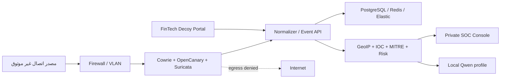

# العمارة التقنية

## المبدأ

الواجهة المالية هي سطح خداع مستقل، وواجهة SOC هي سطح إدارة خاص. كلاهما يقرأ من API موحّد، بينما تبقى طبقة الاستشعار في منطقة معزولة لا تملك مسار خروج إلى الإنترنت أو الشبكة الداخلية.

## مناطق الثقة

1. **Public/Untrusted**: لا يُستخدم محليًا في النسخة الحالية.
2. **Decoy zone**: الخدمات الوهمية فقط، read-only root filesystem، إسقاط capabilities، شبكة `internal`، وحدود حجم/وقت.
3. **Telemetry zone**: استقبال أحداث مُقيدة عبر schema، لا أوامر ولا shell.
4. **Data zone**: PostgreSQL/Redis/Elastic دون منافذ عامة.
5. **SOC zone**: وصول عبر VPN/OIDC/MFA عند النشر؛ محليًا على loopback فقط.

## العقود الأساسية

كل حدث يملك الحقول المشتركة التالية: `event_id`, `timestamp`, `session_id`, `source`, `source_ip`, `service`, `action`, `severity`, `risk_score`, `mitre`, `geo`, `ioc`, `executed:false`.

الـAPI يستخدم prefix ثابتًا: `/api/v1`، مع health/readiness، pagination، بحث وفلاتر، وWebSocket للبث الاصطناعي. عند غياب API تستخدم الواجهات fallback داخليًا كي تظل قابلة للعرض.

## المحاكاة الآمنة

- parser محدود للأوامر المسموحة؛ لا `subprocess`, `os.system`, `eval`, `exec`.
- كل filesystem افتراضي ومحدود داخل session state.
- روابط المهاجم تُسجّل كنص وتُعقّم، ولا تُطلب عبر الشبكة.
- الملفات تُخزّن خارج web root مع quota وhash؛ التحليل الديناميكي غير مفعّل محليًا.
- LLM يولّد نصًا فقط من structured context، مع حد طول، output filter، وبدون tools/network.
- بيانات الحسابات والمال والأشخاص وهمية ولا تستعمل أسماء علامات مالية حقيقية.

## قابلية التوسع

النسخة المحلية تعمل بـJSON وSQLite لتقليل الحمل. Profile `core` يضيف PostgreSQL وRedis، و`search` يضيف Elastic/Kibana، و`ai` يضيف Ollama/Qwen. المستشعرات الحقيقية تبقى profile منفصلًا على Linux VM أو host منفصل.

